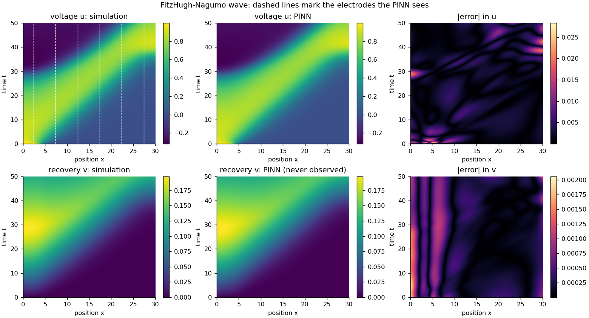
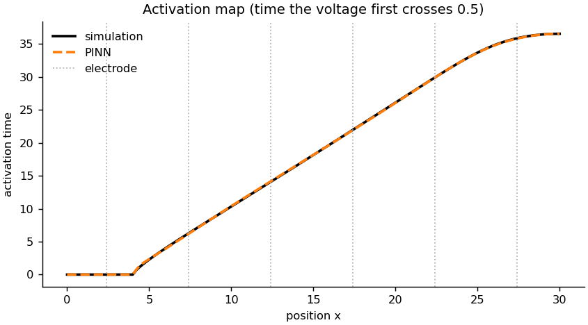
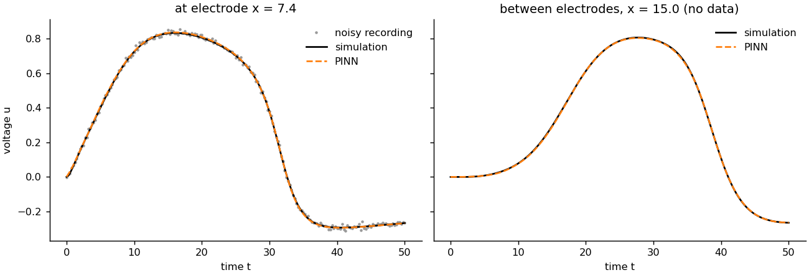
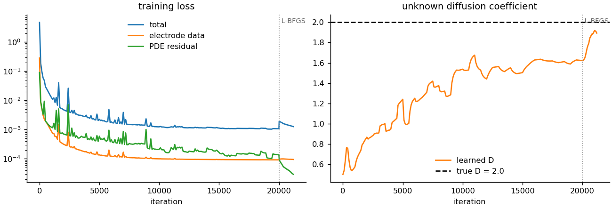

# Physics-Informed Model of the Heart's Electrical Activity

A **physics-informed neural network (PINN)** that reconstructs an action-potential wave travelling through
cardiac tissue from just **6 noisy "electrode" recordings**, and at the same time **learns an unknown tissue
property** (the diffusion coefficient *D*, i.e. how well the tissue conducts).

The network is never shown the full voltage field and never sees the slow recovery variable at all. It fills
in everything between the electrodes by obeying the **FitzHugh-Nagumo equations** of cardiac electrophysiology.

## The physics

The FitzHugh-Nagumo cable model describes the normalised transmembrane voltage *u* and a slow recovery
variable *v* along a strip of excitable tissue:

$$\frac{\partial u}{\partial t} = D\,\frac{\partial^2 u}{\partial x^2} + u(1-u)(u-a) - v,
\qquad \frac{\partial v}{\partial t} = \varepsilon\,(u - \gamma v)$$

with $a = 0.1$, $\varepsilon = 0.01$, $\gamma = 0.5$, no-flux boundaries, and a stimulus at the left end at $t = 0$.
The first term spreads the voltage through the tissue (diffusion), the cubic term models the ion currents that
make the cell fire, and *v* brings the voltage back to rest (repolarisation).

## Results

| | Value |
|---|---|
| Voltage *u*: relative L2 error over the whole tissue | **0.64%** |
| Recovery *v* (never observed): relative L2 error | **0.41%** |
| Activation-time error, mean / max | **0.039** / 0.19 time units (wave takes ~37 units to cross) |
| Diffusion coefficient *D* | learned **1.89** vs true 2.0 (5.33% error, starting guess 0.5) |
| Data used | 6 electrodes = 3.97% of the spatial grid, Gaussian noise σ = 0.01 |



**Activation map**: the time at which each point of the tissue first depolarises (*u* crosses 0.5). This is
what clinicians look at in electro-anatomical mapping, and the PINN recovers it everywhere, including between
electrodes.



At an electrode the PINN filters out the measurement noise; between electrodes, where it has no data at all, it
still follows the true action potential:



## How it works

1. **Ground truth** (`src/simulator.py`): the equations are solved with an explicit finite-difference scheme
   (second-order Laplacian, forward Euler, Δx = 0.2, Δt = 0.005, stability-checked) on a 30-unit strip for 50
   time units.
2. **Sparse data**: the voltage is "recorded" at 6 equally spaced electrodes with added Gaussian noise.
3. **PINN** (`src/pinn.py`): a 5-layer, 64-unit tanh network maps $(x, t) \mapsto (u, v)$. Derivatives
   $u_t$, $u_x$, $u_{xx}$ and $v_t$ come from automatic differentiation. *D* is a trainable parameter
   (learned as $\log D$ so it stays positive).
4. **Loss** = electrode data misfit + initial condition + no-flux boundary condition + PDE residuals of both
   equations at random collocation points (resampled every 500 steps).
5. **Training** (`src/train.py`): 20,000 Adam steps with exponential learning-rate decay, then
   1,200 L-BFGS iterations with a 10× physics weight on 20,000 fixed collocation points. Adam alone fits the
   electrodes but leaves *D* about 19% too low (1.62); the L-BFGS stage tightens the physics and pulls *D* towards its
   true value.



## Run it

```bash
python -m venv .venv && source .venv/bin/activate
pip install -r requirements.txt
python src/train.py                                # about 8-9 minutes on a laptop CPU
python src/train.py --iters 2000 --lbfgs-steps 0   # quick smoke test
```

Options include `--n-electrodes`, `--noise`, `--n-colloc`, `--D-init` and `--seed`. Results, figures and the
trained weights (`pinn.pt`) are written to `results/`.

## Project structure

```
src/simulator.py   FitzHugh-Nagumo finite-difference solver and activation-time extraction
src/pinn.py        network, PDE residuals via autograd, grid prediction
src/train.py       data generation, two-phase training, evaluation
src/plots.py       figures
results/           metrics.json, figures, trained weights
```

## Limitations and next steps

* One spatial dimension and a two-variable phenomenological model; real tissue is 3D and anisotropic, and
  detailed ionic models (e.g. Aliev-Panfilov, ten Tusscher) have many more variables.
* The electrode signals here are the transmembrane voltage itself. Real body-surface ECGs measure a smoothed
  projection of it, which would add a forward model to the loss.
* *D* is the hardest quantity to identify: it only enters through the wave's speed and shape. More electrodes
  or longer recordings tighten it.

## License

MIT (see `LICENSE`).
